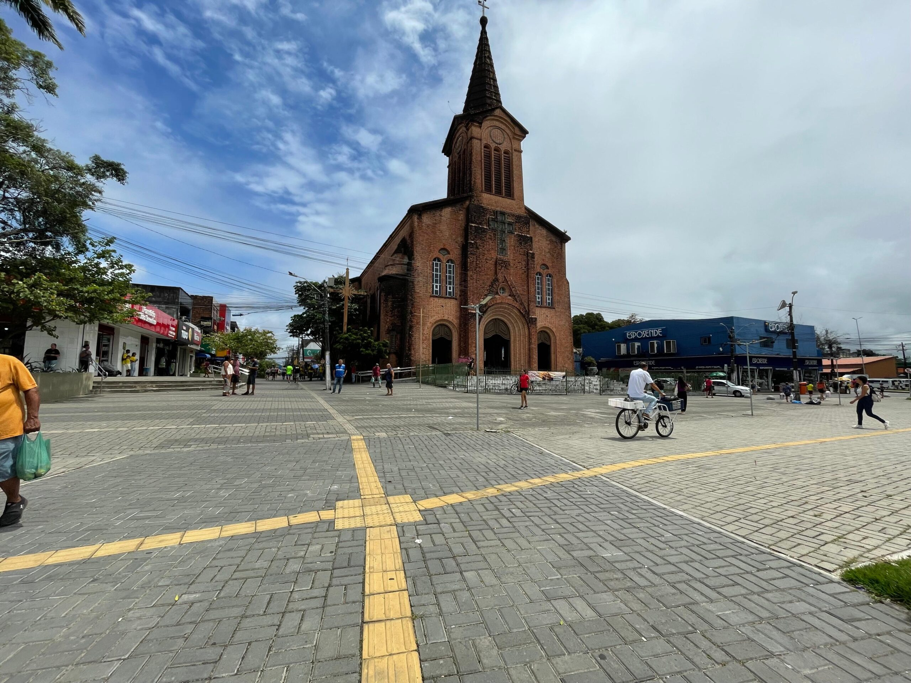
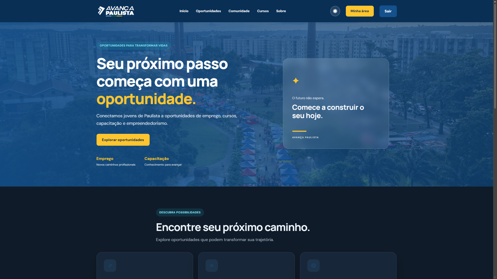
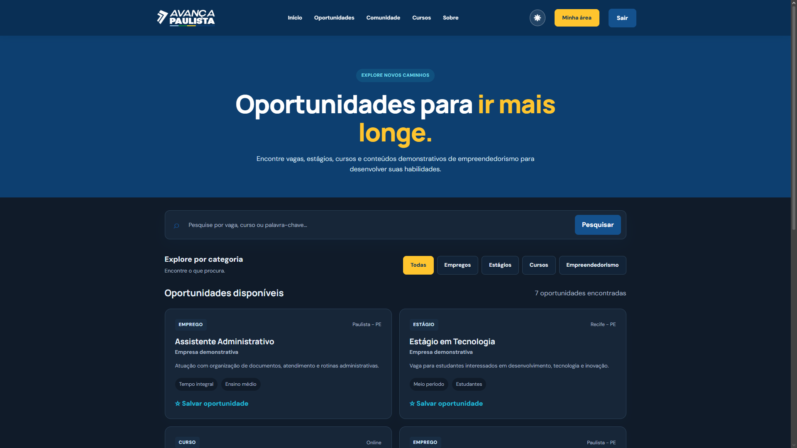
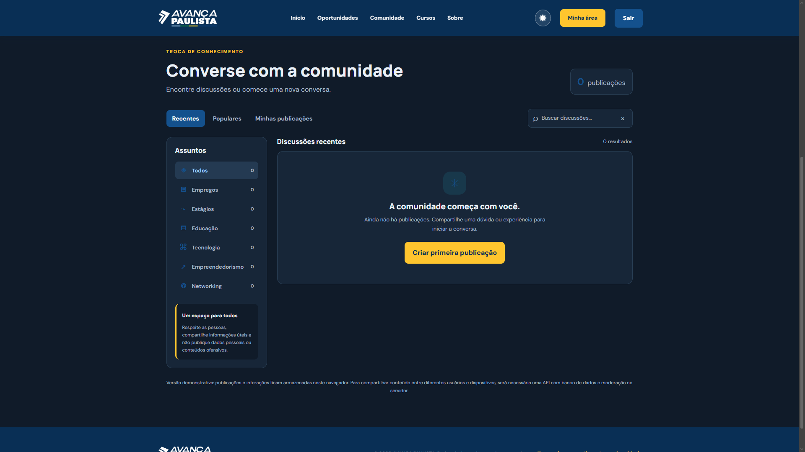
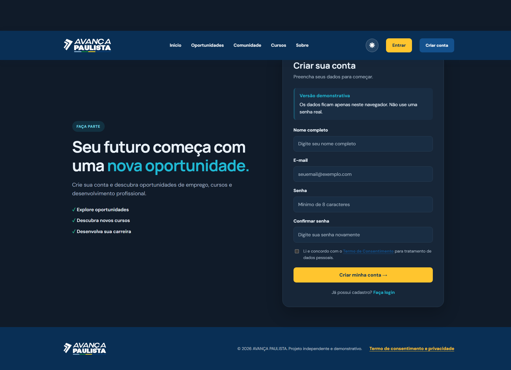
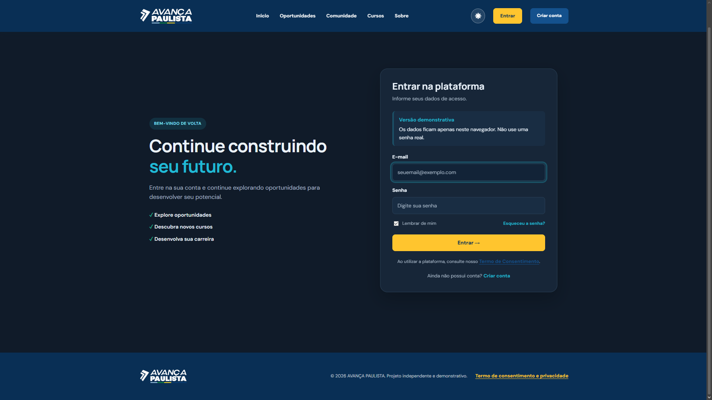
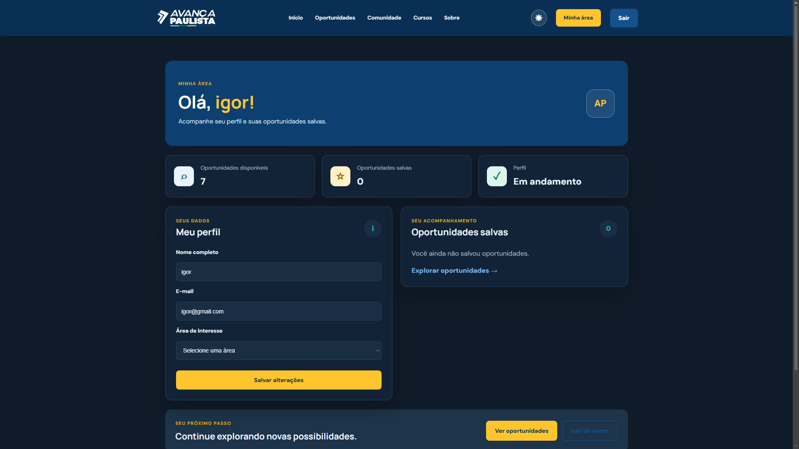
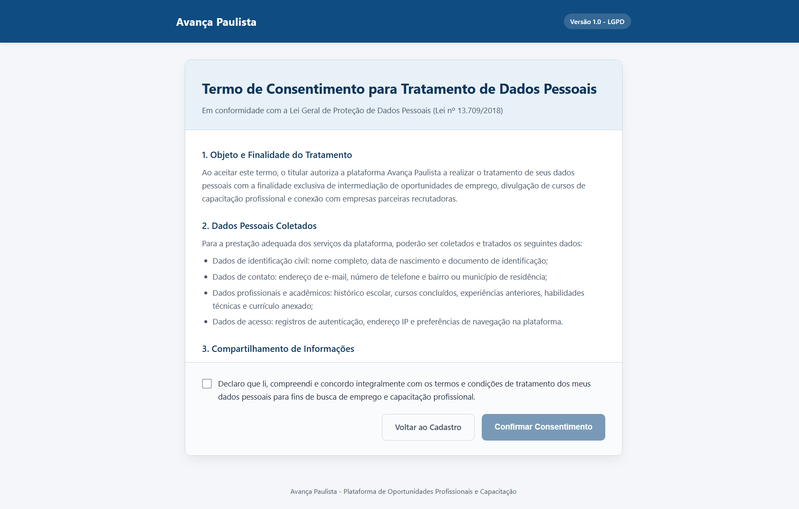
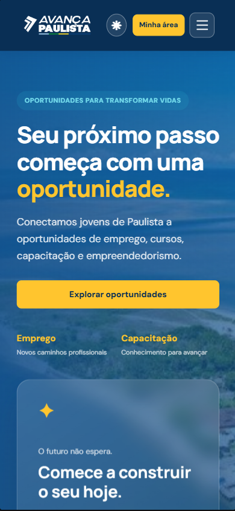
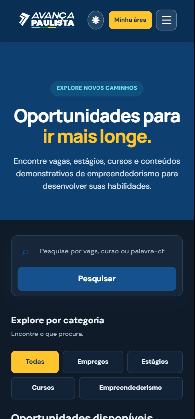

# AVANÇA PAULISTA

<p align="center">
  
</p>

<p align="center">
  <strong>Oportunidades, capacitação e desenvolvimento profissional em um só lugar.</strong>
</p>

<p align="center">
  
  
  
  
</p>

<p align="center">
  🔗 <strong>Demonstração online:</strong> <a href="https://SEU-PROJETO.vercel.app">https://SEU-PROJETO.vercel.app</a>
</p>

<p align="center">
  <a href="#visão-geral">Visão geral</a> •
  <a href="#funcionalidades">Funcionalidades</a> •
  <a href="#tecnologias">Tecnologias</a> •
  <a href="#demonstração-das-telas">Telas</a> •
  <a href="#instalação">Instalação</a> •
  <a href="#equipe">Equipe</a>
</p>

---

## Visão geral

O **AVANÇA PAULISTA** é um projeto acadêmico de desenvolvimento web que propõe reunir, em uma única plataforma, informações demonstrativas sobre oportunidades profissionais, estágios, cursos e iniciativas de desenvolvimento.

A aplicação oferece páginas para explorar oportunidades e cursos, conhecer a proposta do projeto e acessar uma área individual. Também possui fluxos demonstrativos de cadastro, login e recuperação de senha.

O objetivo é apresentar uma experiência de navegação clara, responsiva e coerente, aplicando conceitos de desenvolvimento front-end, componentização, gerenciamento de estado e navegação por rotas.

> **Aviso institucional:** o AVANÇA PAULISTA é um projeto independente e acadêmico. Não representa, não substitui e não deve ser interpretado como serviço oficial da Prefeitura do Paulista ou de qualquer órgão público.

## Identidade visual

A interface utiliza uma identidade visual baseada principalmente em tons de azul, com cores de apoio para destacar ações e informações.

<p align="center">
  
  
  
</p>

As imagens acima fazem parte dos recursos visuais presentes no repositório. A aplicação também utiliza o logotipo e o favicon localizados em `public/assets/`.

## Funcionalidades implementadas

| Área | Recursos disponíveis na versão atual |
|---|---|
| Página inicial | Apresentação da plataforma, seções de destaque e acesso às principais áreas. |
| Oportunidades | Listagem demonstrativa, pesquisa por texto, filtros por categoria e opção de salvar itens. |
| Comunidade | Criação, edição e exclusão de publicações, curtidas, comentários, busca e filtros por categoria. |
| Cursos | Página de apresentação de conteúdos e áreas de capacitação. |
| Sobre | Apresentação da proposta, objetivos e etapas relacionadas ao projeto. |
| Cadastro | Criação de conta demonstrativa com validação de nome, e-mail, senha e aceite dos termos. |
| Login | Entrada em uma conta criada no próprio navegador e opção de lembrar a sessão. |
| Recuperação de senha | Redefinição demonstrativa utilizando os dados locais do navegador. |
| Minha área | Edição do nome e da área de interesse, consulta e remoção de oportunidades salvas e encerramento da sessão. |
| Termo de Consentimento | Página com o termo de tratamento de dados pessoais (LGPD), acessível pelo rodapé, pelo login e pelo cadastro. |
| Preferências visuais | Alternância entre tema claro e escuro, com preferência armazenada localmente. |

**Importante:** as oportunidades e empresas exibidas na versão atual são dados demonstrativos. Não devem ser consideradas vagas reais ou ofertas verificadas.

## Demonstração das telas

### Página inicial

<p align="center">
  
</p>

### Oportunidades

Listagem com busca por texto, filtros por categoria e opção de salvar vagas.

<p align="center">
  
</p>

### Comunidade

Publicações com curtidas, comentários, edição e filtros por categoria.

<p align="center">
  
</p>

### Cadastro e login

<table align="center">
  <tr>
    <td align="center"><br /><sub>Cadastro</sub></td>
    <td align="center"><br /><sub>Login</sub></td>
  </tr>
</table>

### Minha área e Termo de Consentimento

<table align="center">
  <tr>
    <td align="center"><br /><sub>Minha área</sub></td>
    <td align="center"><br /><sub>Termo de Consentimento</sub></td>
  </tr>
</table>

### Versão mobile

<p align="center">
  
  
  
</p>

## Tecnologias

| Tecnologia | Utilização |
|---|---|
| React | Construção da interface por componentes. |
| Vite | Servidor de desenvolvimento e geração do build. |
| JavaScript (ES Modules) | Lógica e interatividade da aplicação. |
| HTML5 | Estrutura do documento principal. |
| CSS3 | Estilização, temas e responsividade. |
| React Router DOM | Navegação entre páginas e controle de rotas. |
| Context API | Compartilhamento dos estados de autenticação e tema. |
| Web Storage API | Persistência demonstrativa no navegador. |
| Git e GitHub | Versionamento e hospedagem do código-fonte. |

## Estrutura do projeto

```text
Avanca-Paulista/
├── docs/
│   └── screenshots/
├── public/
│   ├── assets/
│   │   ├── 1.jpg ... 5.jpg
│   │   ├── favicon.svg
│   │   └── logo-avanca-paulista.png
│   └── termo-de-consentimento.html
├── src/
│   ├── components/
│   │   └── Layout.jsx
│   ├── contexts/
│   │   ├── AuthContext.jsx
│   │   └── ThemeContext.jsx
│   ├── pages/
│   │   ├── About.jsx
│   │   ├── AuthPages.jsx
│   │   ├── Community.jsx
│   │   ├── Courses.jsx
│   │   ├── Dashboard.jsx
│   │   ├── Home.jsx
│   │   └── Opportunities.jsx
│   ├── styles/
│   │   ├── app.css
│   │   ├── dashboard.css
│   │   ├── legacy.css
│   │   └── recovery.css
│   └── main.jsx
├── assets/
│   ├── 1.jpg
│   ├── 2.jpg
│   ├── 3.jpg
│   ├── 4.jpg
│   ├── 5.jpg
│   ├── favicon.svg
│   └── logo-avanca-paulista.png
├── index.html
├── package.json
├── package-lock.json
├── LICENSE
├── README.md
└── README-REACT.md
```

## Instalação

### Pré-requisitos

- [Node.js](https://nodejs.org/) instalado.
- npm, incluído na instalação do Node.js.
- Git, caso deseje clonar o repositório.

Confira as versões disponíveis:

```bash
node --version
npm --version
```

### 1. Clone o repositório

```bash
git clone https://github.com/davidzinnn2007/Avanca-Paulista.git
```

### 2. Acesse a pasta do projeto

```bash
cd Avanca-Paulista
```

### 3. Instale as dependências

```bash
npm install
```

### 4. Inicie o servidor de desenvolvimento

```bash
npm run dev
```

O Vite exibirá no terminal o endereço local para acessar a aplicação. Normalmente:

```text
http://localhost:5173
```

## Scripts disponíveis

| Comando | Descrição |
|---|---|
| `npm run dev` | Inicia o servidor de desenvolvimento. |
| `npm run build` | Gera os arquivos otimizados para produção na pasta `dist/`. |
| `npm run preview` | Disponibiliza uma prévia local do build de produção. |

Para validar a geração de produção:

```bash
npm run build
npm run preview
```

## Rotas da aplicação

| Caminho | Página | Acesso |
|---|---|---|
| `/` | Página inicial | Público |
| `/oportunidades` | Oportunidades | Público |
| `/comunidade` | Comunidade | Público (interações exigem login) |
| `/cursos` | Cursos | Público |
| `/sobre` | Sobre | Público |
| `/login` | Entrar | Visitantes |
| `/cadastro` | Criar conta | Visitantes |
| `/recuperar-senha` | Recuperar acesso | Visitantes |
| `/dashboard` | Minha área | Requer autenticação local |
| `/termo-de-consentimento.html` | Termo de Consentimento | Público |

Rotas desconhecidas exibem uma página de erro com opção para retornar ao início.

## Persistência, segurança e limitações

Esta versão é um **protótipo front-end**. A estrutura atual não apresenta integração com API ou banco de dados remoto.

- Contas, sessão, perfil, preferências e oportunidades salvas são mantidos no armazenamento do navegador.
- Os dados não são sincronizados entre dispositivos ou usuários.
- A autenticação é demonstrativa e não deve ser utilizada como mecanismo de segurança em produção.
- A senha é transformada em hash SHA-256 no cliente. Isso não equivale ao armazenamento seguro de senhas em um servidor, com algoritmo apropriado para senhas.
- A recuperação de senha altera o registro local e não envia e-mail nem verifica a identidade do solicitante.
- Não utilize senhas reais ou informações pessoais sensíveis nesta versão.

### Evoluções técnicas futuras

Uma versão de produção deverá considerar:

1. API para regras de negócio e acesso aos dados.
2. Banco de dados para contas, perfis e oportunidades.
3. Autenticação e autorização implementadas no servidor.
4. Armazenamento seguro de senhas com algoritmo apropriado.
5. Recuperação de senha com verificação por canal confiável.
6. Validação de dados no servidor, proteção contra abuso, logs e monitoramento.

## Equipe

**Grupo:** 1 — Jovem Paulista  
**Tema:** 1 — Mentoria, Emprego e Protagonismo Juvenil

| Integrante | Matrícula |
|---|---:|
| Caio Peryandro Tavares | 01756197 |
| David Rodrigues | 01847148 |
| Igor Bernardo | 01846617 |
| Roberto Eugênio Palácios Gomes | 01241270 |
| Ruan Luiz | 01821025 |

## Contribuição e versionamento

O código-fonte é versionado com Git e hospedado no GitHub. Para contribuir:

1. Crie uma branch para a alteração.
2. Mantenha cada commit focado em uma mudança.
3. Teste as páginas e funcionalidades afetadas.
4. Execute `npm run build` antes de abrir um pull request.
5. Descreva o que foi alterado e como validar a mudança.

Exemplos de prefixos para commits:

| Prefixo | Uso |
|---|---|
| `feat` | Nova funcionalidade |
| `fix` | Correção |
| `style` | Ajustes visuais |
| `refactor` | Refatoração |
| `docs` | Documentação |
| `test` | Testes |

Não versione a pasta `node_modules/` nem arquivos locais que contenham dados pessoais ou segredos.

## Licença

Consulte o arquivo [LICENSE](LICENSE) para os termos de uso do código.

---

<p align="center">
  <strong>AVANÇA PAULISTA</strong><br />
  Projeto acadêmico independente de desenvolvimento web.
</p>
